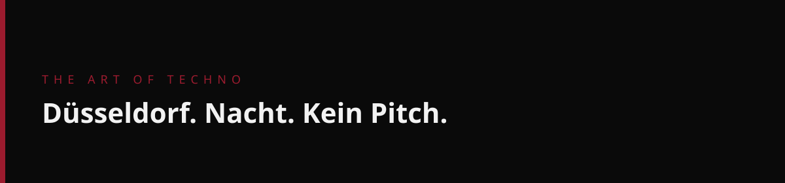

  

<h1 align="center">The Art of Techno</h1>

  Techno. Radio. Apps. Film. 
  Düsseldorf.

  
  
  
  

Kein Pitch. Gebaut wird, was nachts läuft.

## Projekte

| | |
| --- | --- |
| **[Ich liebe Techno](https://github.com/dickGoodman/ich-liebe-techno)** | Dunkler Web-Player. 24/7 Radio, Festival-Notizen, PWA. Near-black, Drumcode-Rot. |
| **[HeimatX](https://github.com/dickGoodman/heimat-x)** | Techno-Artfilm. Bildwelt, Schnitt, Ton. |
| **[OSIRIS](https://github.com/dickGoodman/osiris)** | Live-OSINT-Karte. Flüge, Schiffe, Satelliten, CCTV. [osirisai.live](https://osirisai.live/) |
| **[Field Church](https://github.com/dickGoodman/field-church)** | Projektplatz. Name steht, Umfang noch nicht. |

## Draußen

- X: [@TheArtOfTechno](https://x.com/TheArtOfTechno)
- OSIRIS: [osirisai.live](https://osirisai.live/)
- Player: [ich-liebe-techno](https://github.com/dickGoodman/ich-liebe-techno) — Pages noch in den Repo-Settings einschalten

## Stack

HTML, CSS, JavaScript, PWA, Audio, Karten. Schnitt und KI-Bild als Werkzeug, nicht als Ausrede.

## Profil-Settings, die kein Repo setzen kann

GitHub lässt Name, Bio, Ort, Website und X-Handle nur in den Account-Settings. Sinnvoller Stand:

- **Name:** The Art of Techno
- **Bio:** Techno, Radio, Apps, Film. Düsseldorf. Sarkasmus inklusive.
- **Ort:** Düsseldorf, Deutschland
- **Website:** https://osirisai.live/
- **Social / X:** TheArtOfTechno

Account heißt noch `dickGoodman`. Für die Marke besser umbenennen, sobald `TheArtOfTechno` frei ist. Dieses Repo muss danach denselben Namen tragen, sonst verschwindet das Profil-README.
